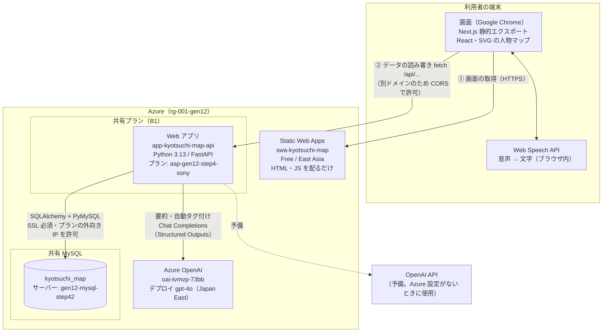
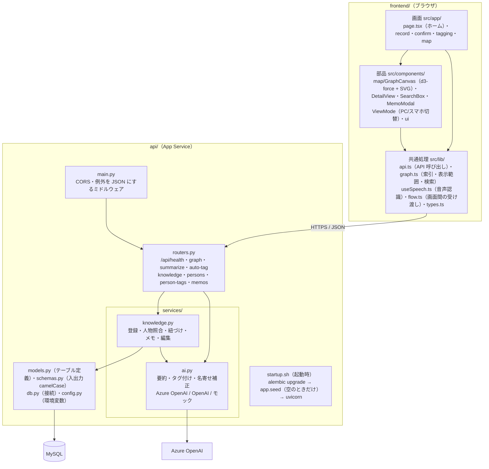
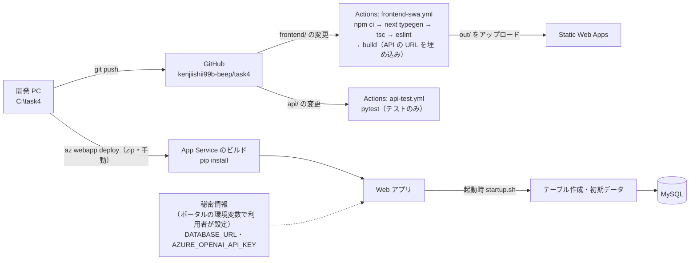
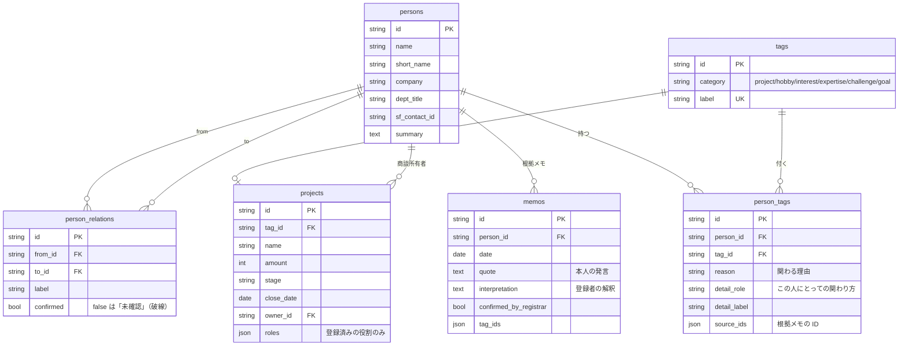

# アーキテクチャ

2026-11-17 時点の構成。処理の順番は [sequence.md](sequence.md)、Azure の設定と手順は [azure-setup.md](azure-setup.md) を参照。

## 1. 全体構成

| 要素 | 役割 | 秘密情報 |
|---|---|---|
| 画面（ブラウザ） | 表示と操作、音声認識。API の URL はビルド時に埋め込み（`NEXT_PUBLIC_API_BASE_URL`） | 持たない |
| Static Web Apps | 静的ファイルの配信のみ（計算はしない） | なし |
| Web アプリ（API） | 唯一の窓口。DB と AI にアクセスできるのはここだけ | `DATABASE_URL`、`AZURE_OPENAI_API_KEY` などを環境変数で保持 |
| MySQL | 人物・タグ・案件・紐づけ・人間関係・メモを保存 | ― |
| Azure OpenAI | 文字起こしの要約、タグの提案（名寄せ） | ― |

## 2. ソフトウェアの層

## 3. デプロイの流れ

API を自動デプロイしないのは、発行プロファイルに必要な基本認証を、共有環境の Web アプリで有効にしないため。

## 4. データモデル

- 人と人は、主に **タグを介して** つながる（`persons` — `person_tags` — `tags`）。同じタグでも、人ごとの関わり方は `person_tags.detail_role` で区別する。
- 直接の人間関係は `person_relations`。共通の趣味だけの接点は `confirmed = false` として「未確認」と表示する。
- 案件はタグの一種（`category = project`）として扱い、商談情報は `projects` に持つ。
