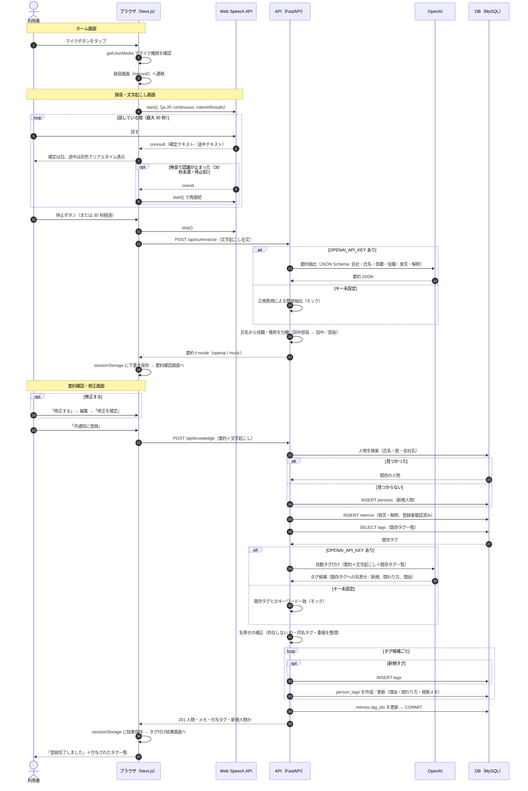
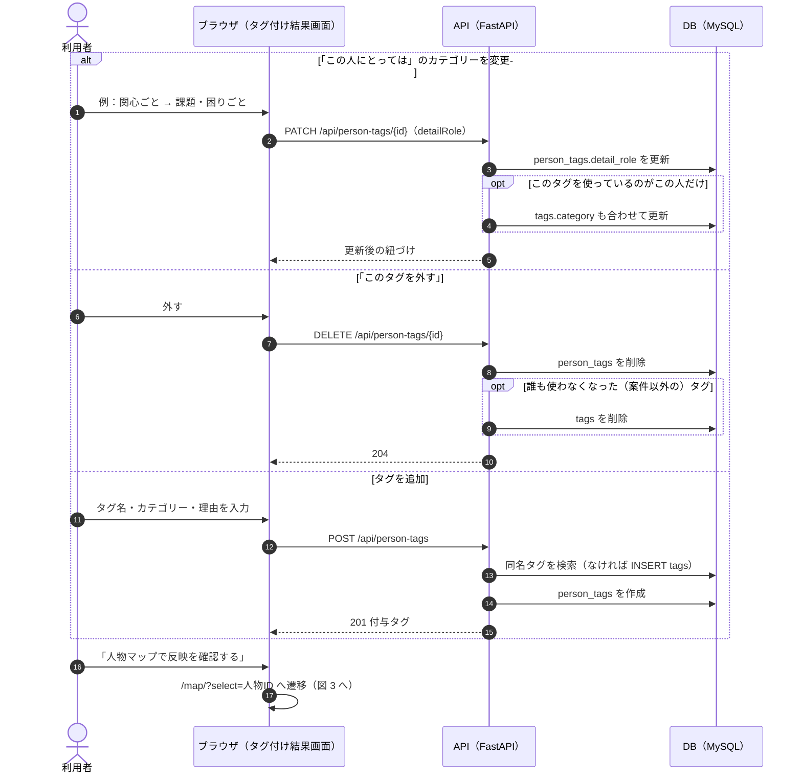
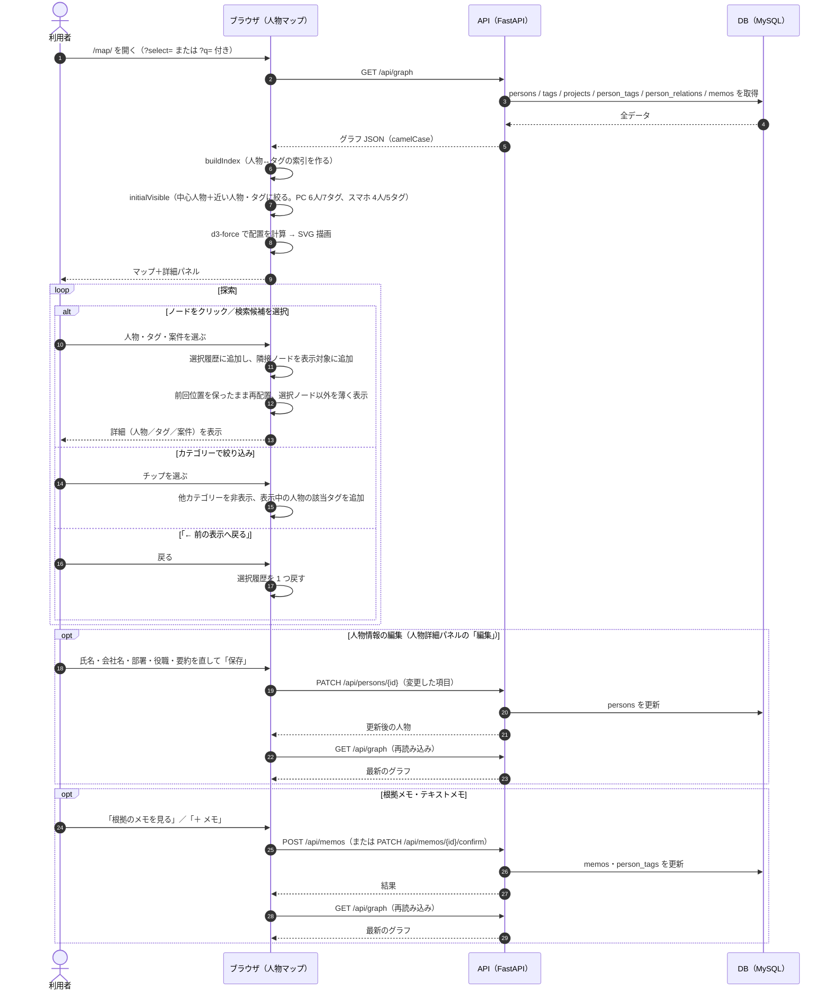

# シーケンス図

実装（2026-11-16 時点）の処理順に合わせた図。登場するもの:

| 名前 | 実体 |
|---|---|
| ブラウザ | Next.js（静的エクスポート）。Azure Static Web Apps から配信 |
| Web Speech API | Chrome 組み込みの音声認識（`webkitSpeechRecognition`） |
| API | FastAPI（App Service `app-kyotsuchi-map-api`） |
| OpenAI | Chat Completions API（`OPENAI_MODEL`、Structured Outputs） |
| DB | Azure Database for MySQL（`kyotsuchi_map`） |

画面間のデータ受け渡しは `sessionStorage`（`frontend/src/lib/flow.ts`）。

## 1. 記録の登録（録音 → 要約 → 確認 → 登録・自動タグ付け）

エラー時: OpenAI の失敗は 502、入力不備は 400、その他は 500（いずれも CORS ヘッダー付きで返し、画面に理由を表示する）。

## 2. タグ付け結果の調整

## 3. 人物マップの表示と探索

