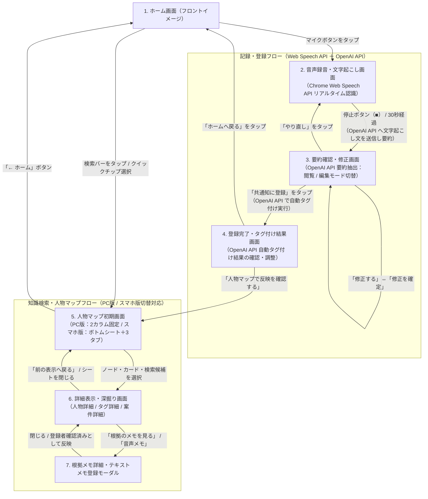

# 共通知＆人物マップ 統合実装仕様書

本ドキュメントは、Google Chromeの **Web Speech API** による音声文字起こしと **OpenAI API** による構造化要約・自動タグ付けで「共通知」を作成するインプットフローと、人物を起点にタグ・案件・人間関係をたどる「人物マップ（PC版・スマホ版レスポンシブ対応）」のアウトプットフローを統合した単一完結型の実装仕様書です。

---

## 1. 全体画面遷移図（Mermaid）

---

## 2. デザイン・カラー・基本原則

### 2.1 UIデザイン原則
* **ダークUI基調:** Obsidianのグラフビューのような余白のあるシンプルなダークテーマを採用する。
* **主語は「人物」:** 人物からタグが広がり、共通テーマや案件を介して人と人につながる。
* **関わる理由の区別:** 同じテーマ（例：「省エネ」）でも、人物ごとに「困っている（課題）」「実現したい（目的）」「経験がある（得意分野）」の違いを明示する。
* **未確認関係の厳格な区別:** 共通の趣味・関心（例：「釣り」）があるだけで面識や協力関係があると断定せず、破線および「面識は未確認」ラベルで区別する。
* **表現の制約:** 3Dの球体、光彩、派手なアニメーション、大量のカード敷き詰め、背景画像の貼り付けは行わず、操作可能なUI部品で構成する。

### 2.2 カラーパレット
* **ベース背景:** `#14161C`
* **パネル背景:** `#1C1F26`
* **カード・浮き上がり要素:** `#242832`
* **本文テキスト:** `#F2F2F4`
* **補助テキスト:** `#B5B8C1`
* **区切り線・枠線:** `#373B44`
* **フォント:** `Noto Sans JP`, `Inter`, sans-serif

### 2.3 カテゴリー定義（全画面・全端末共通）
色だけに依存せず、必ずカテゴリー名テキストを併記する。

| ID | 表示名 | カラーコード | テキスト色 | 代表例 |
| :--- | :--- | :--- | :--- | :--- |
| `project` | 案件 | `#7CC8F8`（青） | `#0F172A` | ポンプ入替工事 |
| `hobby` | 趣味 | `#A4EDC2`（緑） | `#0F172A` | 釣り |
| `interest` | 関心ごと | `#F2C66D`（黄） | `#0F172A` | 省エネ、若手育成 |
| `expertise` | 経験・得意分野 | `#C3A3EB`（紫） | `#0F172A` | 高効率ポンプの提案経験 |
| `challenge` | 課題・困りごと | `#F39892`（コーラル） | `#0F172A` | 電気代が予算を圧迫 |
| `goal` | 目的・取り組み | `#79DDD4`（青緑） | `#0F172A` | IRで発信できる施策 |

---

## 3. 各画面の詳細仕様

### 3.1 ホーム画面（フロントイメージ）
記録（インプット）と知識検索（アウトプット）の2大機能への入り口となる画面。上部に「PC版 / スマホ版」のプレビュー切替トグルを備える（デフォルトは画面幅 `900px` 未満でスマホ版、以上でPC版へ自動判定）。

1. **上部エリア（記録作成）**
   * **表示テキスト:**
     > お疲れ様です。
     > お仕事の記録を残して
     > みんなの共通知を作りましょう
   * **UI要素:** マイクアイコンボタン（青 `#2563EB`）
   * **アクション:** タップでマイク権限を確認し、「音声録音・文字起こし画面」へ遷移する。

2. **下部エリア（知識検索）**
   * **表示テキスト:**
     > 何かお探しですか？
     > 仲間の知識も借りましょう。
   * **UI要素:**
     * 検索入力欄（プレースホルダー：`○○社のキーマンは？`、右端にマイクアイコンボタン）
     * クイック探索チップ（「東都設備・田中部長」「省エネの接点を見る」「ポンプ入替工事」）
   * **アクション:** 入力欄タップ・検索実行・チップ選択のいずれかで「人物マップ画面」へ遷移する（検索文字列や初期選択ノードを引き継ぐ）。

---

### 3.2 音声録音・文字起こし画面（Web Speech API / Google Chrome）
Google Chrome の **Web Speech API（`webkitSpeechRecognition` / `SpeechRecognition`）** を使用し、発話内容をブラウザ上でリアルタイムにテキスト化する画面。

* **API・ブラウザ設定仕様:**
  * **対象環境:** Google Chrome（デスクトップ版 / Android版）
  * **インスタンス設定:** `lang = 'ja-JP'`、`continuous = true`、`interimResults = true`
  * **非対応ブラウザ / 権限拒否時のフォールバック:** `window.SpeechRecognition || window.webkitSpeechRecognition` が未定義、またはマイク権限拒否（`not-allowed`）の場合はエラーバナーを表示し、手入力テキストフォームへ切り替えられるようにする。
* **表示テキスト（上部）:**
  > お疲れ様です。
  > お仕事の記録を残して
  > みんなの共通知を作りましょう
* **入力ガイド（中部ボックス）:**
  > 誰とお会いしましたか？
  > どんな方でしたか？
  > 例えば見た目の特徴とか
  > 趣味とかでもいい displacement。
  > キーマンが分かると仲間も
  > スムーズに仕事が進みますね
* **リアルタイム文字起こしプレビュー:**
  * 確定テキスト（`isFinal === true`）を白文字 `#F2F2F4`、認識途中の暫定テキスト（`interimTranscript`）を補助色 `#B5B8C1` でリアルタイム表示する。
* **UI要素・遷移:**
  * 左上「← キャンセル」ボタン（認識を破棄してホーム画面へ戻る）
  * 録音停止ボタン（赤丸 `#DC2626` に白四角）
  * 10本の音声波形バーアニメーション＋録音時間カウンター（`録音中 00:00 / 00:30` から最大30秒までカウント）
  * 停止ボタン押下または30秒経過で `recognition.stop()` を呼び出し、確定した文字起こし全文を **OpenAI API（要約抽出エンドポイント）** へ送信して「要約確認・修正画面」へ遷移する（送信中はローディング表示を行う）。

---

### 3.3 要約確認・修正画面（OpenAI API 要約抽出結果）
Web Speech API で文字起こししたテキストから、**OpenAI API（Chat Completions API / Structured Outputs）** が構造化抽出した**要約内容（基本情報・発言・解釈）のみ**を確認し、必要に応じて手修正したうえで登録する画面。この段階ではまだタグ付け項目は表示せず、登録処理後に次画面で自動タグ付け結果を表示する。

* **OpenAI API 要約抽出仕様（ステップ1）:**
  * **モデル:** `gpt-4o-mini`（または `gpt-4o`）
  * **出力形式:** `response_format: { type: "json_schema" }` による厳格なJSON出力
  * **抽出フィールド:** `company`（会社名）、`personName`（対象人物名）、`dept`（部署）、`position`（ポジション・役職）、`quote`（本人の発言要旨・原文抜粋）、`interpretation`（関わる理由・商談上の解釈）
* **状態管理（確認モード ⇔ 編集モード）:**
  * **初期状態（確認中）:** 全入力フィールドは読み取り専用（`readonly`）。右上バッジは「確認中」。
  * **編集状態（編集中）:** 「修正する」ボタン押下で全フィールドが編集可能になり、枠線が `#7CC8F8` でハイライトされる。右上バッジは「編集中」に変化する。
* **表示・編集項目フィールド（要約情報のみ）:**
  * 会社名
  * 対象人物名
  * 部署
  * ポジション・役職
  * 本人の発言内容（原文メモ）
  * 関わる理由・登録者の解釈
  * ※「カテゴリー分類」「抽出タグ」はこの画面には配置しない。
* **操作ボタン構成:**
  1. **「やり直し」ボタン:** 音声録音・文字起こし画面へ戻り再録音を行う。
  2. **「修正する」／「修正を確定」ボタン:** 確認モードと編集モードを切り替える。
  3. **「共通知に登録」ボタン:** 確定した要約データと既存のタグ・案件マスター一覧を **OpenAI API（自動タグ付けエンドポイント）** へ送信し、タグ付け結果を生成・保存して「登録完了・タグ付け結果画面」へ遷移する。

---

### 3.4 登録完了・タグ付け結果画面（OpenAI API 自動タグ付け）
共通知への要約登録が完了したことを通知するとともに、登録された要約内容と既存ナレッジをもとに **OpenAI API** が自動生成・名寄せした**タグ付け結果**を一覧表示する画面。

* **OpenAI API 自動タグ付け仕様（ステップ2）:**
  * **処理内容:** 確定した要約（`company`, `personName`, `quote`, `interpretation`）と既存タグマスター（`tags[]`）を入力プロンプトに渡し、既存の共通テーマ（例：`省エネ`、`釣り`）へ名寄せすべきタグと新規作成すべきタグを6カテゴリー（`project` / `hobby` / `interest` / `expertise` / `challenge` / `goal`）へ分類して返す。
  * **出力JSON構造:** `assignedTags: [{ tagId, label, category, reason, detailRole, isNewTag }]`
* **ヘッダー・完了メッセージ:**
  > 登録完了しました。お疲れ様でした。
  > OpenAI API により以下のタグを自動付与しました。
* **自動タグ付け結果カード（表示・調整エリア）:**
  * **対象人物:** 登録された人物名・所属・役職
  * **付与されたタグ一覧（カテゴリーバッジ付き）:**
    * 例：`課題・困りごと`（`#F39892`）：**夜間電力のコスト削減**（理由：省エネ投資の優先順位が高い）
    * 例：`関心ごと`（`#F2C66D`）：**省エネ**（既存共通テーマへ自動名寄せ）
    * 例：`案件`（`#7CC8F8`）：**ポンプ入替工事**（関連商談として紐付け）
  * **タグの追加・変更アクション:** 必要に応じてタグのカテゴリー変更や新規タグの追加・削除を行える（変更内容は即座に人物マップデータへ反映される）。
* **下部アクションボタン:**
  * **「人物マップで反映を確認する」ボタン:** 登録・タグ付けされた対象人物を選択状態で「人物マップ画面」へ遷移する。
  * **「ホームへ戻る」ボタン:** 「ホーム画面」へ遷移する。

---

### 3.5 人物マップ画面（PC版レイアウト）
想定幅 `1280〜1920px`（`1440×900px` 基準）。

1. **最上部ヘッダー:**
   * 左：「← ホーム」ボタン、タイトル「人物マップ」
   * 中央：インクリメンタル検索欄「人・タグ・案件を探す」（人物名・会社名・役職・タグ名・案件名をリアルタイム検索し候補ドロップダウン表示）
   * 右：「📱 スマホ表示プレビュー」切替ボタン、「音声メモ」ボタン
2. **マップ上部フィルターバー:**
   * 「すべて」＋全6カテゴリーチップ（複数選択可）
3. **中央〜左エリア（人物グラフキャンバス）:**
   * **表示密度制御:** 全20名のマスターデータのうち、初期表示は中心人物（田中 健一）および直接関連する主要5人物・7タグ程度を表示し、検索・カテゴリー絞り込み・ノード展開によって他15名の関連ネットワークへ動的に展開できる。
   * **ノード表現:** 人物は淡いグレー系の円形アバター（姓の1文字＋氏名・役職）、タグ・案件はカテゴリー色の丸角ピル型。選択ノードのみ白枠で強調し、無関係なノード・線は透過度を下げる。
   * **エッジ表現:** 人物とタグの線上に「関わる理由」をラベル表示。直接の人間関係（「商談窓口」「よく相談」）と未確認の接点（破線＋「未確認」）を区別する。
   * **操作:** キャンバスドラッグ移動、マウスホイールズーム、左下コントロール（「−」「全体表示」「＋」）。
4. **右端エリア（固定詳細パネル：幅 `390〜430px`）:**
   * マップと独立して縦スクロール可能。「← 前の表示へ戻る」で選択履歴を遡れる。

---

### 3.6 人物マップ画面（スマホ版レイアウト）
想定幅 `360〜430px`（`390×844px` 基準）。PC版と共通のデータ・ID・色を使用しつつ、モバイル専用UIを構成する。

1. **ヘッダー＆前面3カテゴリー絞り込み:**
   * タイトル「人物マップ」、検索欄「人・タグ・案件を探す」。
   * 前面表示チップは「すべて」＋最大3カテゴリー（「趣味」「関心ごと」「案件」）＋「その他」ボタン。「その他」タップで全6カテゴリー選択ボトムシートを開き、適用時は「その他（選択数）」を表示する。
2. **グラフ表示密度の制限:**
   * 初期表示は主要人物3〜4名・主要タグ3〜5個に絞り、画面内の文字重なりと過密を防ぐ（タッチ領域は44×44px以上を確保）。全20名へは「人物」タブまたは検索からアクセスできる。
3. **下部コンパクトカード＆ボトムシート:**
   * マップ下部には選択人物のコンパクトカード（氏名・役職・要約・「この人をひらく」ボタン）と、親指位置の「＋ メモ」ボタンを配置。
   * 「この人をひらく」またはタグ・案件タップで下からボトムシートが展開し、詳細情報を縦スクロールで閲覧できる。
4. **下部3タブナビゲーション:**
   * 「マップ」「人物（全20名の氏名一覧検索）」「メモ（メモ一覧・テキスト登録）」を切り替える。

---

### 3.7 詳細ビュー仕様（人物・タグ・案件・根拠メモ）

#### A. 人物詳細
1. **基本プロフィール:** アバター、氏名、会社名、部署・役職、人物要約。
2. **Salesforceの情報（サンプル）:** 担当営業、関連商談、商談金額、フェーズ、「商談の詳細を見る」ボタン。
3. **ヒアリングで得た人物理解:** カテゴリー色バッジ付きのタグ一覧（各人物3件）と、それぞれの「関わる理由」。マップ側が絞り込み中の場合は「※ マップではカテゴリー絞り込み中（非表示タグも以下に全表示）」と明記。
4. **発言の引用・根拠メモ:** 本人の発言引用、出典日、登録者、「根拠のメモを見る」モーダル起動リンク。
5. **共通テーマでつながる人:** 共通タグを持つ他の人物候補と理由。「※ 共通点による候補・実際の面識は未確認」を明示。

#### B. タグ詳細（例：「省エネ」「釣り」）
* **「省エネ」（関心ごと）:**
  * 関連人物（田中・中村・伊藤 ほか）の接点図を表示。
  * 「関心の背景」として人物別の役割を色分けラベルで区別する：
    * **田中 健一:** `課題・困りごと`／電気代が予算を圧迫（理由：予算圧迫を解消したい）
    * **中村 彩:** `目的・取り組み`／IRで発信できる施策（理由：IR向けの施策を探したい）
    * **伊藤 修:** `経験・得意分野`／高効率ポンプの提案経験（理由：高効率化の提案経験）
  * 関連案件「ポンプ入替工事」への導線を表示。
* **「釣り」（趣味）:**
  * 「共通の関心・趣味。実際の面識は未確認。」を明示。
  * 「会話から見つかった接点」として田中（海釣り）・佐藤（船釣り）・渡辺（渓流釣り）それぞれの発言・出典を表示。

#### C. 案件詳細（例：「ポンプ入替工事」）
* ヘッダーに案件名、青の「案件」バッジ、「Salesforce由来・サンプル」、最終同期日時を表示。
* **商談情報テーブル:** 取引先（東都設備株式会社）、商談金額（1,200万円）、フェーズ（提案・見積）、受注予定日（2026/12/20）、商談所有者（高橋 遥）。
* **関係人物と役割:** 登録済みデータのみ表示（田中＝登録済みの意思決定者、高橋＝営業担当／商談所有者）。役割不明時は「役割未登録」とし、役職からの自動推測を行わない。
* **関連する関心ごと:** 「省エネ」タグへの遷移ボタン。
* **外部リンク制御:** 「Salesforceで開く」ボタンは実URL未設定時は無効化（`disabled`）し、架空リンクを開かない旨を説明する。

#### D. 根拠メモモーダル・新規メモ登録モーダル
* **根拠メモ詳細:** 「本人の発言（原文）」と「登録者の解釈」を枠を分けて表示し、「登録者確認済み」のステータスと共有範囲（社内共有）を明示する。
* **新規テキストメモ登録:** 音声認識を使わずテキストから直接メモ・タグを追加するフォーム。OpenAI API による自動タグ提案または手動選択により、即座にグラフと詳細パネルへ反映される。

---

## 4. 共通データ構造と初期サンプルデータ

### 4.1 データモデル指針
表示状態（選択中のノード、絞り込み中のカテゴリー、ズーム倍率）と永続データを分離し、以下のエンティティをIDで関連付ける。

* `persons`: `{ id, name, shortName, company, deptTitle, sfContactId, summary }`
* `tags`: `{ id, category, label, projectId }`
* `projects`: `{ id, tagId, sfOpportunityId, name, accountName, amount, stage, closeDate, ownerId, lastSync, relatedTagIds, sfUrl, roles[] }`
* `personTags`: `{ id, personId, tagId, reason, detailRole, sourceIds[] }`
* `personRelations`: `{ id, fromId, toId, label, confirmed }`
* `memos`: `{ id, personId, date, context, registrar, quote, interpretation, confirmedByRegistrar, scope, tagIds[] }`

### 4.2 初期サンプルデータ一覧（すべて架空）

#### 人物（20名）および各人物に紐づくタグ・案件（1人あたり3件）
全20名の人物データに対し、それぞれ**3つのタグ・案件**を紐づけて定義する（共通タグ・共通案件を介したネットワーク探索を可能にする）。

| No. | ID | 氏名 | 所属・役職 | Salesforce ID（サンプル） | 紐づくタグ・案件（3件）とカテゴリー・関わる理由 |
| :--- | :--- | :--- | :--- | :--- | :--- |
| 1 | `p-tanaka` | 田中 健一 | 東都設備株式会社・設備部長 | `0035g00000Sample01` | 1. `省エネ`（関心ごと：予算圧迫を解消したい） 2. `釣り`（趣味：週末は海釣りに行く） 3. `ポンプ入替工事`（案件：登録済みの意思決定者） |
| 2 | `p-nakamura` | 中村 彩 | 東都設備株式会社・開発部 | `0035g00000Sample02` | 1. `省エネ`（関心ごと：IR向けの施策を探したい） 2. `IRで発信できる施策`（目的・取り組み：次期IRでの環境取り組み発信） 3. `カーボンニュートラル`（関心ごと：Scope2排出量の可視化） |
| 3 | `p-ito` | 伊藤 修 | 自社・技術担当 | `null` | 1. `省エネ`（関心ごと：高効率化の提案経験） 2. `高効率ポンプの提案経験`（経験・得意分野：同規模工場での導入実績あり） 3. `ポンプ入替工事`（案件：技術支援・試算担当） |
| 4 | `p-sato` | 佐藤 美咲 | 東都設備株式会社・購買課長 | `0035g00000Sample03` | 1. `釣り`（趣味：最近、船釣りを始めた ※面識未確認） 2. `コスト最適化`（課題・困りごと：相見積もり基準の厳格化） 3. `ポンプ入替工事`（案件：購買契約窓口） |
| 5 | `p-takahashi` | 高橋 遥 | 自社・営業担当 | `null` | 1. `ポンプ入替工事`（案件：商談所有者） 2. `法人深耕営業`（経験・得意分野：設備更新案件のクロージング） 3. `カフェ巡り`（趣味：休日はロースタリー巡り） |
| 6 | `p-suzuki` | 鈴木 大輔 | 東都設備株式会社・工場長 | `0035g00000Sample04` | 1. `老朽化設備の更新`（課題・困りごと：突発停止リスクをゼロにしたい） 2. `若手育成`（関心ごと：現場オペレーターの多能工化） 3. `ゴルフ`（趣味：月1回の社内コンペ幹事） |
| 7 | `p-yamamoto` | 山本 恵子 | 東都設備株式会社・経理財務部長 | `0035g00000Sample05` | 1. `電気代が予算を圧迫`（課題・困りごと：固定費比率の上昇を抑制したい） 2. `補助金・税制優遇の活用`（目的・取り組み：省エネ投資の初期費用圧縮） 3. `ヨガ・ピラティス`（趣味：週2回のスタジオ通い） |
| 8 | `p-watanabe` | 渡辺 誠 | 京浜マテリアル株式会社・生産技術部長 | `0035g00000Sample06` | 1. `省エネ`（関心ごと：コンプレッサーの電力ロス削減） 2. `釣り`（趣味：渓流ルアーフィッシング ※面識未確認） 3. `空圧機器リプレイス案件`（案件：技術評価責任者） |
| 9 | `p-kobayashi` | 小林 由美 | 京浜マテリアル株式会社・サステナビリティ推進室 | `0035g00000Sample07` | 1. `IRで発信できる施策`（目的・取り組み：統合報告書へのKPI掲載） 2. `カーボンニュートラル`（関心ごと：再エネ比率向上と省エネ連携） 3. `美術館巡り`（趣味：現代アート展の鑑賞） |
| 10 | `p-kato` | 加藤 隆司 | 京浜マテリアル株式会社・資材調達グループ長 | `0035g00000Sample08` | 1. `コスト最適化`（課題・困りごと：原材料高騰に伴う設備予算見直し） 2. `空圧機器リプレイス案件`（案件：発注決裁ルート管理） 3. `マラソン`（趣味：フルマラソン完走目標） |
| 11 | `p-yoshida` | 吉田 健太 | 自社・ソリューション営業部 課長 | `null` | 1. `空圧機器リプレイス案件`（案件：商談所有者） 2. `補助金・税制優遇の活用`（経験・得意分野：省エネ補助金申請サポート実績） 3. `ゴルフ`（趣味：顧客とのラウンド交流） |
| 12 | `p-yamada` | 山田 直樹 | 関東ロジスティクス株式会社・施設管理部長 | `0035g00000Sample09` | 1. `電気代が予算を圧迫`（課題・困りごと：冷凍冷蔵倉庫の24時間稼働電力） 2. `冷凍機・空調更新プロジェクト`（案件：登録済みの意思決定者） 3. `キャンプ`（趣味：家族でのオートキャンプ） |
| 13 | `p-sasaki` | 佐々木 麻衣 | 関東ロジスティクス株式会社・経営企画室 | `0035g00000Sample10` | 1. `カーボンニュートラル`（目的・取り組み：2030年CO2削減ロードマップ策定） 2. `冷凍機・空調更新プロジェクト`（案件：投資対効果の社内稟議担当） 3. `カフェ巡り`（趣味：スペシャルティコーヒー愛好） |
| 14 | `p-yamaguchi` | 山口 浩二 | 関東ロジスティクス株式会社・現場保全リーダー | `0035g00000Sample11` | 1. `老朽化設備の更新`（課題・困りごと：冷媒フロン規制への早期対応） 2. `若手育成`（課題・困りごと：ベテラン保全担当の定年退職対策） 3. `サウナ`（趣味：週末のサウナ巡り） |
| 15 | `p-matsumoto` | 松本 翔太 | 自社・エネルギー診断チーム リーダー | `null` | 1. `冷凍機・空調更新プロジェクト`（案件：省エネ診断・提案主担当） 2. `高効率ポンプの提案経験`（経験・得意分野：熱源・搬送動力のトータル診断） 3. `サウナ`（趣味：出張先でのローカルサウナ開拓） |
| 16 | `p-inoue` | 井上 真由美 | 中央フードテック株式会社・品質保証部長 | `0035g00000Sample12` | 1. `HACCP・衛生管理強化`（目的・取り組み：空調・換気システムのクリーン化） 2. `ボイラー高効率化案件`（案件：品質基準レビュー担当） 3. `料理・パン作り`（趣味：休日の天然酵母パン作り） |
| 17 | `p-kimura` | 木村 拓也 | 中央フードテック株式会社・製造部 部長 | `0035g00000Sample13` | 1. `老朽化設備の更新`（課題・困りごと：蒸気ボイラーの燃費悪化とメンテナンス負荷） 2. `ボイラー高効率化案件`（案件：登録済みの意思決定者） 3. `マラソン`（趣味：市民ランナーとして大会出場） |
| 18 | `p-hayashi` | 林 智子 | 中央フードテック株式会社・総務人事部長 | `0035g00000Sample14` | 1. `若手育成`（目的・取り組み：製造現場のDXリテラシー教育） 2. `補助金・税制優遇の活用`（関心ごと：人材開発・省エネ関連助成金の調査） 3. `ヨガ・ピラティス`（趣味：健康経営推進の一環で実践） |
| 19 | `p-shimizu` | 清水 健介 | 自社・カスタマーサクセス担当 | `null` | 1. `ボイラー高効率化案件`（案件：導入後フォロー・運用定着担当） 2. `HACCP・衛生管理強化`（経験・得意分野：食品工場向け稼働モニタリング支援） 3. `キャンプ`（趣味：ソロキャンプ道具収集） |
| 20 | `p-mori` | 森 亮太 | 自社・事業開発部 マネージャー | `null` | 1. `カーボンニュートラル`（目的・取り組み：脱炭素ソリューションの新規パッケージ化） 2. `法人深耕営業`（経験・得意分野：複数拠点展開企業への横展開戦略） 3. `美術館巡り`（趣味：建築・デザイン展の視察） |

---

#### タグ・案件マスター一覧（計24件：タグ20件＋案件4件）
上記20名の各人物が3件ずつ紐づく共通・固有ノード群。

| ID | カテゴリー | 表示名 | 紐づく人物（人数） |
| :--- | :--- | :--- | :--- |
| `t-energy` | `interest`（関心ごと） | 省エネ | 田中 健一、中村 彩、伊藤 修、渡辺 誠（4名） |
| `t-training` | `interest`（関心ごと） | 若手育成 | 田中 健一、鈴木 大輔、山口 浩二、林 智子（4名） |
| `t-carbon` | `interest`（関心ごと） | カーボンニュートラル | 中村 彩、小林 由美、佐々木 麻衣、森 亮太（4名） |
| `t-budget` | `challenge`（課題・困りごと） | 電気代が予算を圧迫 | 山本 恵子、山田 直樹（2名） |
| `t-aging` | `challenge`（課題・困りごと） | 老朽化設備の更新 | 鈴木 大輔、山口 浩二、木村 拓也（3名） |
| `t-cost` | `challenge`（課題・困りごと） | コスト最適化 | 佐藤 美咲、加藤 隆司（2名） |
| `t-ir` | `goal`（目的・取り組み） | IRで発信できる施策 | 中村 彩、小林 由美（2名） |
| `t-subsidy` | `goal`（目的・取り組み） | 補助金・税制優遇の活用 | 山本 恵子、吉田 健太、林 智子（3名） |
| `t-haccp` | `goal`（目的・取り組み） | HACCP・衛生管理強化 | 井上 真由美、清水 健介（2名） |
| `t-pump-exp` | `expertise`（経験・得意分野） | 高効率ポンプの提案経験 | 伊藤 修、松本 翔太（2名） |
| `t-sales-exp` | `expertise`（経験・得意分野） | 法人深耕営業 | 高橋 遥、森 亮太（2名） |
| `t-fishing` | `hobby`（趣味） | 釣り | 田中 健一、佐藤 美咲、渡辺 誠（3名 ※面識未確認） |
| `t-golf` | `hobby`（趣味） | ゴルフ | 鈴木 大輔、吉田 健太（2名 ※面識未確認） |
| `t-marathon` | `hobby`（趣味） | マラソン | 加藤 隆司、木村 拓也（2名 ※面識未確認） |
| `t-sauna` | `hobby`（趣味） | サウナ | 山口 浩二、松本 翔太（2名） |
| `t-cafe` | `hobby`（趣味） | カフェ巡り | 高橋 遥、佐々木 麻衣（2名 ※面識未確認） |
| `t-yoga` | `hobby`（趣味） | ヨガ・ピラティス | 山本 恵子、林 智子（2名 ※面識未確認） |
| `t-art` | `hobby`（趣味） | 美術館巡り | 小林 由美、森 亮太（2名 ※面識未確認） |
| `t-camp` | `hobby`（趣味） | キャンプ | 山田 直樹、清水 健介（2名 ※面識未確認） |
| `t-cooking` | `hobby`（趣味） | 料理・パン作り | 井上 真由美（1名） |
| `o-pump` | `project`（案件） | ポンプ入替工事 | 田中 健一、伊藤 修、佐藤 美咲、高橋 遥（4名） |
| `o-air` | `project`（案件） | 空圧機器リプレイス案件 | 渡辺 誠、加藤 隆司、吉田 健太（3名） |
| `o-fridge` | `project`（案件） | 冷凍機・空調更新プロジェクト | 山田 直樹、佐々木 麻衣、松本 翔太（3名） |
| `o-boiler` | `project`（案件） | ボイラー高効率化案件 | 井上 真由美、木村 拓也、清水 健介（3名） |

---

## 5. API連携・実装セキュリティ上の注意事項

1. **Web Speech API（Google Chrome）の扱い:**
   * `SpeechRecognition` は HTTPS 環境（または `localhost`）でのみ動作し、ユーザージェスチャー（ホーム画面のマイクボタンタップ）を起点に `recognition.start()` を実行する。
   * 無音タイムアウト（`onspeechend` / `onend`）で録音が意図せず停止した場合は、録音時間が30秒未満かつユーザー停止前でなければ自動で `recognition.start()` を再接続して連続文字起こしを維持する。
2. **OpenAI API キー管理とプロキシ構成:**
   * ブラウザ側のフロントエンドコードに直接 `OPENAI_API_KEY` をハードコードしない。本番実装ではサーバーサイドのAPIルート（例：`/api/summarize`、`/api/auto-tag`）を経由して OpenAI API を呼び出す（ローカル単体プロトタイプで試す場合のみ、ユーザーが自身のAPIキーを設定モーダルから入力して `sessionStorage` に一時保持する方式を許容する）。
3. **Salesforce連携:**
   * プロトタイプ段階ではすべてモックデータで動作させ、連携表示には「サンプル」を付与する。実API接続時は認証情報・閲覧権限を引き継ぎ、クライアント側に秘密情報を埋め込まない。